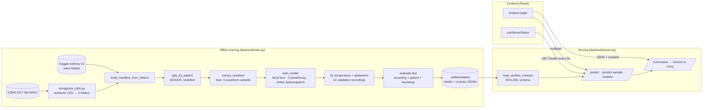

# RespiNet: Verified Project Context

> **Round 2b update (2026-10-23, supersedes the figures below where they differ).** The served model
> is now a four-member late fusion: a 3-seed RespiNet ensemble plus logistic heads over frozen
> YAMNet, OPERA-CE and HeAR embeddings. It was chosen by pre-registered patient-grouped
> cross-validation and trained with 21 KAUH patients added (split v3).
>
> - **Test set (49 patients):** **75.5% patient-level / 82.0% recording-level accuracy** (95% CI
>   63–88%; balanced 74.9% / 73.5%). Split v3 has different test patients, so this is not comparable
>   with the earlier 73.3%.
> - **KAUH holdout (24 held-out patients from the same hospital):** **healthy 17/18 correct but COPD
>   0/5**. The model follows what the site's training patients mostly were. This is within-site
>   adaptation, not generalization to a new hospital.
> - The earlier model's external failure (0/45, exact CI 0–7.9%) remains a key finding.
>
> Details: `ROUND2_EXPERIMENTS_REPORT.md` §9.

> **Round 2 update (2026-10-22, supersedes the figures below where they differ).** Kaggle clips cut
> from the KAUH hospital dataset now carry their real patient IDs, which changed the split. The served
> RespiNet + YAMNet model, retrained on the corrected split, scores **73.3% patient-level / 81.3%
> recording-level accuracy** on 45 test patients (95% CI 60–87%; balanced 71.9% / 70.5%). **On 45
> external KAUH patients from another hospital and stethoscope it scores 0%: healthy and COPD patients
> are called "asthma"**, because almost all KAUH-recorded training audio is asthma and all COPD audio is
> ICBHI. Probes show every representation identifies the dataset or stethoscope far more easily than
> the disease. Present the in-cohort numbers only as in-cohort results, and present the external
> failure as a key finding. Details: `ROUND2_EXPERIMENTS_REPORT.md`.

**Purpose.** This is a single, detailed, *verified* reference for the RespiNet / Respiratory Atlas
repository, for developers, AI assistants, and LLMs that generate reports or presentations.
Each quantitative claim here is traced to a source file. Where existing documentation
disagrees with the code or the run artifacts, this document says so explicitly (§14).

| Field | Value |
|---|---|
| Verified on | 2026-10-21; **updated 2026-10-22** for the final phase (see §0) |
| Repository revision | `1b81cff` originally; final-phase updates on branch `final-phase-improvements` |
| Verification method | Full read of `backend/*.py`, `frontend/src/**`, infra/CI files and all `documentation/*.md`; numbers re-computed from `backend/artifacts/latest/*.json` |
| Not verified | Run 1241 (its log is not in the repo). Test suite (70 tests) and live server behavior were verified on 2026-10-22 after the venv was rebuilt |
| Companion files | [`../CLAUDE.md`](../CLAUDE.md), [`../backend/CLAUDE.md`](../backend/CLAUDE.md), [`../frontend/CLAUDE.md`](../frontend/CLAUDE.md), [`PROJECT_RESEARCH_CHRONICLE_AND_ARCHITECTURE_EVOLUTION.md`](PROJECT_RESEARCH_CHRONICLE_AND_ARCHITECTURE_EVOLUTION.md) (the mandatory living chronicle) |

> **Safety framing.** RespiNet is a research and education prototype. It is not clinically
> validated and must not be used to diagnose, screen for, rule out, or treat disease.

---

## 0. Final-phase update (2026-10-22) — read first

Full details: [`FINAL_PHASE_IMPROVEMENT_REPORT.md`](FINAL_PHASE_IMPROVEMENT_REPORT.md) and
[`ACCURACY_EXPERIMENTS_REPORT.md`](ACCURACY_EXPERIMENTS_REPORT.md).

- **Current served model (branch `accuracy-experiments`): RespiNet + YAMNet late fusion.** The
  RespiNet network and a logistic-regression head over frozen YAMNet embeddings (16 kHz, mean+std
  of 1,024-d frames) are each temperature-calibrated, averaged 50/50 and calibrated again
  (temperatures 0.7133 / 0.9992 / final 0.6744). Test: **84.46% recording / 77.55% patient
  accuracy** (95% CI 65.3–89.8%), balanced 79.87% / 76.22%, macro AUROC 0.971 / 0.953, ECE 0.031 /
  0.088. By source (patient): ICBHI 65.38%, Kaggle 91.30%. It was chosen by 3-fold patient-grouped
  CV on the 194 development patients (+4.6 balanced accuracy over RespiNet alone, P = 0.97) before
  the test set was used. Code: `backend/pretrained.py`, `main.py --fusion yamnet`,
  `backend/experiments/cv.py`. The RespiNet-only model below is archived in
  `backend/artifacts/v3-2026-10-22-leakfree/`.

- **Cross-dataset leakage found and removed.** 631 of the 1,211 Kaggle V2 clips (52%, including all
  401 COPD clips) are verbatim cuts of ICBHI recordings that were also in the merged cohort, under
  different pseudo-patient IDs. Kaggle `P`-numbers are not subject IDs. These clips and 12 byte
  duplicates are now dropped (evidence: `backend/data/kaggle_icbhi_overlap.csv`). **Corrected
  cohort: 1,488 recordings / 243 patients.**
- **Retrained, same model and settings (then superseded by the fusion above):** test accuracy **77.36% recording / 75.51% patient**
  (95% CI 63.3–87.8%), balanced accuracy 71.42% / 73.72%, macro AUROC 0.927 / 0.932, T = 0.713.
  By source: ICBHI 65.4%, Kaggle 87.0% (patient level). The 2026-08-14 model's 82.09% (§9) was
  inflated by the leakage.
- **Fixed in code:** fail-closed serving (no legacy fallback), denoising off by default, strict
  upload signatures, Gemini key in a header, ICBHI labels checked against the published
  distribution, complete run metadata, a real dataset audit, portable manifests, per-source
  metrics, and strict-JSON metrics.
- Sections 4.6, 7–9 and 10/12 below describe the **pre-audit** state where marked. The
  discrepancy register (§14) and defect list (§15) carry per-item status.

---

## Contents

1. [Project identity](#1-project-identity)
2. [Timeline (git-verified)](#2-timeline-git-verified)
3. [System architecture](#3-system-architecture)
4. [Data: datasets, labels, patient grouping](#4-data-datasets-labels-patient-grouping)
5. [Signal processing & features](#5-signal-processing--features)
6. [Model: RespiNet-Attention v3](#6-model-respinet-attention-v3)
7. [Training procedure](#7-training-procedure)
8. [Calibration, abstention & evaluation](#8-calibration-abstention--evaluation)
9. [Current model: verified results](#9-current-model-verified-results)
10. [Inference API](#10-inference-api)
11. [Frontend](#11-frontend)
12. [Infrastructure, environments & compute](#12-infrastructure-environments--compute)
13. [Tests & CI](#13-tests--ci)
14. [Discrepancy register](#14-discrepancy-register-docs-vs-reality)
15. [Known defects & risks](#15-known-defects--risks)
16. [Documentation index with trust levels](#16-documentation-index-with-trust-levels)
17. [Glossary](#17-glossary)

---

## 1. Project identity

- **Name:** RespiNet (product UI name: *Respiratory Atlas*). Full title: *Respiratory Disease
  Recognition Through Respiratory Sound with the Help of Deep Neural Networks*.
- **Task:** recording-level, multi-class classification of lung-auscultation audio into
  disease categories, aggregated to patient level for evaluation.
- **Current label space (5 classes, alphabetical = model output order):**
  `asthma`, `bronchial`, `copd`, `healthy`, `pneumonia`.
- **Historical label space (8 ICBHI classes):** Asthma, Bronchiectasis, Bronchiolitis, COPD,
  Healthy, LRTI, Pneumonia, URTI. Used by the 2021 model `backend/best_model.h5`.
- **Contributors (from git):** Victor Basu (2021 origin, 10 commits) and Oren Coelho (`qitiya`,
  2026 modernization, 30 commits).
- **Intended audiences (design.md):** respiratory researchers, clinicians reviewing research,
  students and educators.

---

## 2. Timeline (git-verified)

| Date | Commit(s) | Event |
|---|---|---|
| 2021-01-18 → 2021-06-26 | Victor Basu commits | Original Keras Conv1D + BiGRU on ICBHI 2017, 8 classes. The later audit found sample-level random splits (leakage), pre-split augmentation, 200-frame truncation, unmasked padding, and no filtering |
| 2026-05-09 → 05-13 | `1809b94` … `1473cb2` | Full-stack app: frontend, Flask server, noise cancellation, expanded scope (LLM reports, explainability) |
| 2026-07-10 → 07-31 | `f6c8693`, `053b837` | "upgraded boi" commits. The 07-31 audit (`ARCHITECTURE_AND_BENCHMARK_REPORT.md`) rated maturity 49/100 |
| 2026-08-02 | `62a1e50` | Project refactor, Respiratory Atlas frontend (`CHANGELOG.md`) |
| 2026-08-03 | `95f22a4`, `37b67b2` | Containerization, remade frontend, training prep. Contract/windowing/masking/calibration safeguards |
| 2026-08-05 | `9812573` … `28284b9` (13 commits) | SPIT GPU cluster work: download job, GPU fixes, "icbhi final baseline" (Run 1241 era), then the **switch to the Kaggle Asthma V2 dataset** |
| 2026-08-11 | `0b24a6f` | Training-loop modifications |
| 2026-08-12 | `e7b0ec8` | v3 architecture (dual pooling, residual GRUs, L2 1e-4), callback changes |
| 2026-08-13 | `63ff915` | OOM fix: chunked extraction + online SpecAugment |
| 2026-08-14 | `4bed315`, `95e659b` | **Merged Kaggle + ICBHI dataset**, authentic ICBHI labels, current model trained (artifact timestamps 18:39–19:56), docs updated |
| 2026-09-09 | `1b81cff` | Presentation dossiers, two chronicle bullet points, rebuilt `frontend/dist` |

Phase narratives (with motivation) are in the chronicle §2. Treat its numeric claims with the
caveats in §14.

---

## 3. System architecture



Shared contract: `backend/preprocessing.py:PreprocessingConfig` is used by both training and
serving. It is serialized into `model_metadata.json` and restored at server start.

---

## 4. Data: datasets, labels, patient grouping

### 4.1 Datasets on disk (`backend/dataset/`, gitignored)

| Directory | Content | Source |
|---|---|---|
| `Asthma_Detection_V2/Asthma Detection Dataset Version 2/Asthma Detection Dataset Version 2/{asthma,Bronchial,copd,healthy,pneumonia}/` | 1,211 recordings, filenames like `P54WheezingIE_269.wav` | Kaggle `mohammedtawfikmusaed/asthma-detection-dataset-version-2` |
| `ICBHI_final_dataset/` | 920 WAVs, `<patient>_<rec>_<loc>_<mode>_<device>.wav` | Kaggle mirror `husninm/icbhi-2017-challenge` (via `download_dataset.sh`) |
| `ICBHI_as_folders/{asthma,bronchial,copd,healthy,pneumonia}/` | ICBHI re-sorted by `reorganize_icbhi.py` | generated |
| `patient_diagnosis_authentic.csv` | **real** ICBHI per-patient diagnoses | sourced 2026-08-14 |

### 4.2 The two diagnosis CSVs (critical)

- `backend/patient_diagnosis.csv` (tracked) holds **deliberately scrambled** labels: per-patient
  counts Asthma 13, Bronchiectasis 13, Bronchiolitis 17, COPD 13, Healthy 21, LRTI 13,
  Pneumonia 18, URTI 18 (126 rows). It was kept to make unverified training fail closed.
  *Correction (2026-10-21):* `backend/dataset_provenance.json` describes an **earlier** scrambled
  CSV (sha256 `4b6e…`, slightly different counts), so the current CSV already failed the checksum
  check. The real weakness was that the label-count check accepted self-declared counts, and
  `submit.sh` regenerated the provenance file from whatever CSV was present. Both are fixed in
  final-phase item 6: counts must now equal the published distribution.
- `backend/dataset/patient_diagnosis_authentic.csv` (untracked) holds the real distribution:
  COPD 64, Healthy 26, URTI 14, Bronchiectasis 7, Bronchiolitis 6, Pneumonia 6, LRTI 2,
  Asthma 1 (126 patients). The same counts are hard-coded as
  `dataset_provenance.ICBHI_2017_PATIENT_COUNTS`.
- Sorting ICBHI with the scrambled CSV (the `reorganize_icbhi.py` default) caused a 27–29%
  val-accuracy collapse. Chronicle §8.5 documents the incident and the fix.

### 4.3 Why ICBHI alone fails as an 8-class, 3-way patient split

Asthma has 1 patient and LRTI has 2. A patient-disjoint train/val/test split needs at least 3
patients per class. `assert_three_way_class_support()` rejects such label sets. That left
three options: redesign the task (4-class grouping, `dataset_provenance.LABEL_MAPPING_4CLASS`),
exclude patients (the Kaggle guide excludes 103, 108, 115), or change the dataset. The project
chose to merge with Kaggle V2 under a 5-class mapping.

### 4.4 Label mappings (two different ones exist)

| ICBHI label | 5-class (`reorganize_icbhi.py`, **current model**) | 4-class (`--dataset-format icbhi --group-classes 4-class`) |
|---|---|---|
| COPD | copd | COPD |
| Healthy | healthy | Healthy |
| Pneumonia | pneumonia | Acute_Infection |
| Asthma | asthma | Non_COPD_Chronic |
| URTI | bronchial | Acute_Infection |
| Bronchiectasis | bronchial | Non_COPD_Chronic |
| Bronchiolitis | bronchial | Acute_Infection |
| LRTI | bronchial | Acute_Infection |

Kaggle folder names are lowercased (`Bronchial` → `bronchial`), so both sources share one
label space.

### 4.5 Patient identity

- ICBHI format: the integer filename prefix (`101_…` → 101).
- Folder format: `100000 + int(sha256(key)[:12], 16) % 800000`, where `key =
  f"{class}_P{digits}"` if the filename starts with an optional `P`/`p` followed by digits,
  else `f"{class}_{relative_path}"`. Kaggle `P54…` files therefore group by subject within a
  class folder. Merged ICBHI files group by the real patient number (namespaced by class).
- Result for the current cohort: Kaggle 1,211 recordings → 205 pseudo-patients, and ICBHI 920
  → 126 patients, for **331 patients** in total.

### 4.6 Cohort composition (recordings)

> **Superseded (2026-10-22):** the table below is the *pre-audit* merged cohort. 631 of its Kaggle
> rows are copies of ICBHI recordings. The leakage-free cohort is ICBHI 920 + Kaggle remainder 568
> = **1,488 recordings** after overlap removal and the 12-file dedup: asthma 289, bronchial 107, copd
> 793, healthy 88, pneumonia 211. ICBHI contributes 1 / 54 / 793 / 35 / 37 and the Kaggle remainder
> 288 / 53 / 0 / 53 / 174 (`backend/artifacts/latest/dataset_audit.json`).

| Class | Kaggle V2 | ICBHI (5-class) | Total |
|---|---:|---:|---:|
| copd | 401 | 793 | 1,194 |
| pneumonia | 285 | 37 | 322 |
| asthma | 288 | 1 | 289 |
| healthy | 133 | 35 | 168 |
| bronchial | 104 | 54 (URTI 23 + Bronchiectasis 16 + Bronchiolitis 13 + LRTI 2)† | 158 |
| **Total** | **1,211** | **920** | **2,131** |

Kaggle counts come from `backend/artifacts/latest/dataset_audit.json`. Totals come from
`split_summary.json`. The ICBHI column is derived as the difference. †The per-subclass breakdown
is not stored in any artifact. It was computed on 2026-10-21 by joining
`dataset/ICBHI_final_dataset/*.wav` with `patient_diagnosis_authentic.csv`. That gives authentic
ICBHI recordings per class of COPD 793, Pneumonia 37, Healthy 35, URTI 23, Bronchiectasis 16,
Bronchiolitis 13, LRTI 2, Asthma 1 (920 in total). The chronicle's table (URTI 86, Bronchiectasis 34,
Bronchiolitis 27) is wrong (see §14 D12).

---

## 5. Signal processing & features

Exact pipeline (`preprocessing.py`, defaults = current artifact's `preprocessing` block):

1. **Load**: `librosa.load(sr=22050, mono=True, res_type="kaiser_fast")`, with a fallback to
   the default resampler. Rejects empty or non-finite audio.
2. **Band-pass**: Butterworth order 4, 100–2000 Hz, second-order sections, `sosfiltfilt`
   (zero-phase).
3. **MFCC**: 40 coefficients, `n_fft=2048` (92.9 ms), `hop_length=512` (23.2 ms ≈ 43.07
   frames/s), librosa defaults otherwise (128 mel bands, centered frames).
4. **Dynamics**: `librosa.feature.delta` (order 1 and 2, default width 9), stacked to
   **120 dims/frame**.
5. **CMVN**: per-feature mean/std over the **entire recording** (not per window), ε = 1e-8.
6. **Windowing**: 200 frames (≈4.64 s) with hop 100. The final window is anchored at `T−200`,
   and recordings of 200 frames or fewer are zero-padded with `valid_length` recorded.
   Padding frames are exactly zero, which is how `FeatureValidityMask` detects them.

Waveform augmentation (training split only): `noise_20db` (SNR-relative Gaussian),
`shift_right_1600` (72.6 ms, zero-filled), `stretch_1.2`, `stretch_0.8`, for up to 5 variants
per recording including the original. Feature augmentation: SpecAugment with 2 frequency
masks (≤15 of 120 dims) and 2 time masks (≤25 frames), applied **online** per batch by default.

Serving-only option: spectral-subtraction denoising (`server._apply_noise_reduction`, median
noise profile of the first 0.5 s, ×1.2). It is **not** part of training, and it is enabled by
default via `RESPINET_ALLOW_INFERENCE_DENOISING=1`. The user must still tick the checkbox.

---

## 6. Model: RespiNet-Attention v3

Source: `backend/model.py:instantiate_model`. Total **458,701 trainable parameters**
(`model_summary.txt`, 1.75 MB weights; the `.keras` file is 5.6 MB).

| # | Block | Configuration | Output |
|---|---|---|---|
| 0 | Input | MFCC+Δ+Δ² window | (B, 200, 120) |
| 1 | `FeatureValidityMask` | `reduce_any(x ≠ 0, -1)` | (B, 200) bool |
| 2 | `LayerNormalization` | over features | (B, 200, 120) |
| 3 | `MultiScaleConvBlock` | 3 parallel Conv1D (k = 3, 5, 11; 32 ch each; GELU; L2 1e-4) → concat 96 → `SqueezeExcitation1D` (r=4) → `SpatialDropout1D(0.2)` | (B, 200, 96) |
| 4 | `bigru_1` | `Bidirectional(GRU(128, activation=None, L2 1e-4))`, masked → GELU → Dropout 0.3 | (B, 200, 256) |
| 5 | `skip_proj` | Conv1D(256, k=1, L2) → LayerNorm on block 3's output | (B, 200, 256) |
| 6 | `residual_add` | block 4 + block 5 | (B, 200, 256) |
| 7 | `bigru_2` | `Bidirectional(GRU(64, activation=None, L2))`, masked → GELU | (B, 200, 128) |
| 8 | `MaskedDualTemporalPooling1D` | concat of (a) tanh-attention (128 units) softmax-weighted mean over valid frames and (b) masked max over time | (B, 256) |
| 9 | Head | Dense 128 + GELU + Dropout 0.3 → Dense 64 + GELU + Dropout 0.4 → Dense 5 softmax (all L2 1e-4) | (B, 5) |

Design rationale (chronicle Phase 6): the multi-scale kernels cover crackle (short) through
wheeze (sustained) time scales. Dual pooling keeps both sustained-sound averages and
transient peaks. The residual path carries local spectral texture past `bigru_1`. Masking
stops padding from reaching the recurrent state and the pooling.

Registered custom objects (package `respinet`): `FeatureValidityMask`,
`MaskedGlobalAveragePooling1D` (legacy, unused in v3), `SqueezeExcitation1D`,
`MultiScaleConvBlock`, `MaskedDualTemporalPooling1D`, `CategoricalFocalLoss`.

**Architecture lineage:**
legacy 2021 (Conv1D 64→64, BatchNorm, BiGRU 32→16 per the chronicle, ~8 outputs) →
v2 (masking, LayerNorm, Conv1D 64/64, BiGRU 64/32, masked GAP, ~137K params, documented in the
chronicle §4.2) → v2-attention (`MultiScaleConvBlock` + single attention pooling) →
**v3 (current)**.

---

## 7. Training procedure

| Setting | Value used for the current artifact | Code default (`main.py` CLI → `train_model`) |
|---|---|---|
| Split | 60/20/20 by patient, stratified, seed 42 | same |
| Batch size | **64** (per the chronicle/dossier; not recorded in metadata) | CLI **32** → overrides `train_model`'s 64 |
| Max epochs | **80** (chronicle §8.6); stopped after 76 | CLI **50** |
| Loss | `CategoricalFocalLoss(γ=2, α=0.25)` + label smoothing | always on; CLI smoothing 0.1 (`train_model` default 0.08) |
| Optimizer | Adamax, `CosineDecay(3e-4, steps=⌈N/B⌉·epochs, alpha=5e-3)` | LR not exposed on the CLI |
| Class weights | sklearn `balanced` over training windows: asthma 3.42, bronchial 3.06, copd 0.27, healthy 3.68, pneumonia 2.64 | from `model_metadata.json` |
| Selection | `ModelCheckpoint` + `EarlyStopping(patience 18, min_delta 0.003, restore_best)` on **window-level `val_accuracy`** | same |
| Augmentation | 4 waveform variants + online SpecAugment | same |
| Hardware | NVIDIA RTX 4060 8 GB (chronicle Phase 6), Python 3.11.9, NumPy 2.4.6 | – |

Batch size and label smoothing are not recorded in `model_metadata.json`. That is a
provenance gap. The values above come from the docs and are consistent with the CLI command
in the chronicle.

Training curve (`training_history.json`): epoch 1 val_acc 0.046 → best **epoch 58: val_acc
0.8080, val_loss 0.1103, train_acc 0.8729** → stopped after epoch 76 (val_acc 0.7909). The
minimum val_loss also falls at epoch 58. Loss values are focal-loss magnitudes, so they are
not comparable to cross-entropy.

---

## 8. Calibration, abstention & evaluation

- **Aggregation:** window probabilities → arithmetic mean per recording (`source_path`) →
  mean per patient (evaluation only).
- **Temperature scaling:** `p_k^(1/T) / Σ p_j^(1/T)` (equivalent to dividing log-probs by T).
  T is chosen by a 161-point log-grid search over [0.25, 5] that minimizes validation NLL on
  recording-level probabilities. The current fit is **T = 0.8443**: the model was slightly
  *under*-confident, so calibration sharpens the probabilities.
- **Abstention** (80% target validation coverage): uncertain if `max p < 0.6386` **or**
  normalized entropy `H/ln K > 0.5276`. The API then returns `prediction: "uncertain"` and
  still includes `model_prediction`.
- **Metrics** (`evaluate.py`): accuracy, balanced accuracy, macro precision/recall/F1,
  weighted F1, Cohen's κ, MCC, log loss, multiclass Brier, 10-bin ECE with curve, confusion
  matrix, sklearn report, per-class sensitivity/specificity, macro one-vs-rest AUROC.
  Patient-level CIs come from a 1,000-sample patient bootstrap (95% percentile).

---

## 9. Current model: verified results

> [!CAUTION]
> **Superseded on 2026-10-22.** The numbers in this section describe the 2026-08-14 model, whose
> cohort contained 631 Kaggle clips that are verbatim copies of ICBHI recordings, so they are
> **contaminated by leakage**. The leakage-free retrain (test accuracy 77.36% recording / 75.51%
> patient, 49 test patients) is reported in
> [`FINAL_PHASE_IMPROVEMENT_REPORT.md`](FINAL_PHASE_IMPROVEMENT_REPORT.md) item 9, and the current
> RespiNet + YAMNet fusion (84.46% / 77.55%) in
> [`ACCURACY_EXPERIMENTS_REPORT.md`](ACCURACY_EXPERIMENTS_REPORT.md) and
> [`../CLAUDE.md`](../CLAUDE.md) §6. This section is kept as a historical record.

Source: `backend/artifacts/latest/test_metrics.json`. Test split: 67 patients / 443
recordings, never used for selection or calibration. Probabilities are temperature-calibrated.

### 9.1 Headline metrics

| Metric | Recording level (n = 443) | Patient level (n = 67) |
|---|---:|---:|
| Accuracy | **80.81%** | **82.09%** |
| Balanced accuracy | 75.03% | 79.65% |
| Macro F1 | 0.7200 | 0.7922 |
| Weighted F1 | 0.8112 | 0.8199 |
| Cohen's κ | 0.7035 | 0.7692 |
| MCC | 0.7118 | 0.7746 |
| Macro OvR AUROC | 0.9465 | 0.9672 |
| Log loss | 0.5577 | 0.5682 |
| Multiclass Brier | 0.2902 | 0.2776 |
| ECE (10 bins) | 0.0333 | 0.1030 |

Patient-bootstrap 95% CIs: accuracy 73.1–91.0%, balanced accuracy 69.6–89.3%, macro F1
67.5–88.6%, macro recall 69.6–89.3%.

### 9.2 Per-class sensitivity / specificity

| Class | Rec. support | Rec. sens | Rec. spec | Pt. support | Pt. sens | Pt. spec |
|---|---:|---:|---:|---:|---:|---:|
| asthma | 54 | 88.9% | 97.2% | 12 | 83.3% | 98.2% |
| bronchial | 24 | 58.3% | 97.6% | 10 | 60.0% | 98.2% |
| copd | 258 | 82.2% | 94.6% | 23 | 91.3% | 97.7% |
| healthy | 41 | 48.8% | 96.3% | 11 | 63.6% | 94.6% |
| pneumonia | 66 | 97.0% | 89.7% | 11 | 100.0% | 89.3% |

### 9.3 Confusion matrices (rows = true, cols = predicted; order asthma, bronchial, copd, healthy, pneumonia)

```text
Recording level                     Patient level
[[ 48,  0,   4,  0,  2],            [[10, 0,  1, 0,  1],
 [  0, 14,   2,  4,  4],             [ 0, 6,  0, 3,  1],
 [  6,  9, 212, 10, 21],             [ 0, 1, 21, 0,  1],
 [  5,  1,   3, 20, 12],             [ 1, 0,  0, 7,  3],
 [  0,  0,   1,  1, 64]]             [ 0, 0,  0, 0, 11]]
```

### 9.4 Interpretation notes for reports

- The dominant error mode is **healthy → pneumonia** (12 of 41 healthy recordings) and
  **copd → pneumonia/healthy/bronchial**. Pneumonia has high recall but the lowest
  specificity.
- `bronchial` (a heterogeneous grouped class: Kaggle "Bronchial" + ICBHI
  URTI/Bronchiectasis/Bronchiolitis/LRTI) and `healthy` are the weakest classes (sensitivity
  58% / 49% at recording level).
- **Dataset-source confounding is possible.** COPD is 66% ICBHI, while asthma (288/289) and
  pneumonia (285/322) are mostly Kaggle. The model may partly learn recording-source/device signatures.
  No per-source breakdown has been computed. Report this as a limitation, or compute it from
  `split_manifest.csv` paths.
- Test sets are small at patient level (10–23 per class). Use the bootstrap CIs.
- Kaggle "patients" are inferred from filename prefixes, not documented subject IDs.
- No external, prospective, or cross-device validation exists.

### 9.5 Historical / non-current numbers

| Claim | Status |
|---|---|
| Legacy 2021 model: 82.12% final train, 73.44% final val, 75.36% best val at epoch 48 | From README / EvidencePage. Leakage-prone sample-level split. **Not a valid performance estimate** |
| Run 1241 (ICBHI 8-class, SPIT cluster): train 67.97%, val 11.90%, val_loss 6.8942, early-stopped at epoch 11 | Reported in the chronicle and the optimization plan. `respinet_train_1241.log` is **not in the repo**, so it cannot be verified here |
| Merged run with scrambled ICBHI labels: val ≈ 27–29% | Chronicle §8.5. The root-level `artifacts/latest/split_summary.json` (tracked) appears to be that run's split |

---

## 10. Inference API

Base: `backend/server.py` (Flask). Local default `127.0.0.1:5001`. Docker uses `0.0.0.0:5000`.
Fail-closed: without a verified contract every inference endpoint, and `/summarize`, returns 503.

| Endpoint | Purpose | Notes |
|---|---|---|
| `GET /live` | liveness | always 200 |
| `GET /ready` | strict readiness | 503 unless the verified contract loaded |
| `GET /health` | diagnostics (UI polls it) | never loads the model; reports `model_contract` = `verified-metadata` or `unverified`, plus `denoise_allowed` |
| `POST /predict` | multipart `file` (+`denoise`) | full-recording windowed, calibrated, with abstention |
| `GET /predict-sample/<class>` | demo using the first matching dataset file | no patient IDs returned |
| `POST /explain` | prediction + time-only gradient saliency for the best window, spectrogram/saliency/overlay PNGs, optional LLM reasoning | the attribution is explicitly labeled experimental |
| `POST /summarize` | LLM research summary | needs `external_llm_consent=true` and an API key |

LLM provider order: Gemini (`gemini-2.5-flash`, REST) if `GEMINI_API_KEY` is set, else Groq
(`llama-3.1-8b-instant`). Patient context is allowlisted (`age, sex, bmi, smoker_status,
pack_years, symptom_days, cough_type, sputum_color, temperature_c, spo2, respiratory_rate,
heart_rate, capture_mode, symptoms[], exposures[]`). Free text and identifiers are dropped.
The prompts require markdown sections and non-diagnostic language.

Operational controls: request IDs, `no-store` / `nosniff` / `DENY` headers, an optional bearer
token, a per-process in-memory rate limit (30/min/IP), 25 MB upload cap, and a 1–120 s
decoded-duration window. See `backend/CLAUDE.md` §4 for the full environment variable list.

---

## 11. Frontend

React 19 + Vite SPA. Routes: `/` Landing, `/analyze`, `/evidence`, `/learn`, `/report`,
`/explainability`, plus legacy redirects. Core flow on `/analyze`: choose upload, mic recording
(MediaRecorder + live VU meter) or a dataset sample → `POST /predict` → calibrated
probabilities, a radial confidence ring, an entropy bar and an uncertainty banner → optional
consented LLM report (`/report`) or explainability (`/explainability`, uploads/recordings
only). Zustand holds the current analysis, the report, and the last 5 results (in memory).
The "Respiratory Atlas" design system (warm ivory, indigo, serif headings, restrained motion,
WCAG AA) is specified in `design.md`. Details and stale-content list:
[`../frontend/CLAUDE.md`](../frontend/CLAUDE.md).

---

## 12. Infrastructure, environments & compute

| Item | Detail |
|---|---|
| Python | 3.11.9 (`backend/.python-version`). Deps in `backend/requirements.txt`: Flask 3, flask-cors, gunicorn, TensorFlow ≥2.13 <3 (Keras 3 era), `nvidia-*-cu12` wheels, librosa 0.10+, resampy, soundfile, numpy, pandas 2, scikit-learn, matplotlib, python-dotenv |
| Node | 20 (CI / Docker) |
| `docker-compose.yml` | `backend` (backend/Dockerfile → gunicorn 2 workers × 4 threads, non-root uid 10001, port 5000, mounts `./backend/dataset`) + `frontend` (nginx, ports 80 and 8080, proxies to `backend:5000`) |
| Root `Dockerfile` | single image: builds the frontend, installs nginx, runs **`python server.py`** (Flask dev server) behind nginx :80 |
| Model in images | `backend/artifacts/latest/` is gitignored, so it is only present if it exists in the build context. Otherwise inference returns 503 (fail-closed) |
| SPIT GPU cluster | SLURM jobs `backend/submit.sh` (1 GPU, 32 CPU, 64 GB, 24 h; `uv venv`; CUDA lib path export; trains the merged folder cohort and no longer writes provenance) and `download_dataset.sh`. Usage guide: `SPIT_GPU_SERVER_GUIDE.md` |
| Kaggle notebooks | `KAGGLE_TRAINING_GUIDE.md` (ICBHI path; excludes patients 103, 108, 115) |
| Local machine | NVIDIA RTX 4060 8 GB. No swap, so the pre-fix pipeline OOM'd at ~22–26 GB (chronicle §8.4) |
| Secrets | `.env` (root) and `backend/.env` are gitignored and may contain `GEMINI_API_KEY`. `.env.example` documents the variables |

---

## 13. Tests & CI

- `backend/tests/`: **70** pytest tests across 17 files (21 before the final phase). Coverage:
  artifact contract, upload signatures, augmentation, calibration, evaluation (including strict
  JSON), patient metrics, preprocessing, fail-closed serving, denoise gating, LLM key handling,
  provenance and reorganization, cohort integrity (dedup, overlap exclusion, audit, per-source
  metrics), the cross-dataset matcher, run metadata, splitting, and windowing. All are
  dataset-free.
- `pyproject.toml`: pytest `testpaths=["tests"]`, `-q`. Ruff targets py310, line length 100,
  rules `E4,E7,E9,F`, and excludes `frontend, artifacts, dataset`.
- CI (`.github/workflows/checks.yml`, on every push/PR): Python 3.11 → `pip install -r
  requirements-dev.txt` → `ruff check .` → `pytest`; Node 20 → `npm ci` → `npm run build`.
- Gaps: no model-graph test, no successful-`/predict` test with a real model, and no frontend tests.

---

## 14. Discrepancy register (docs vs reality)

Each row was checked against code or artifacts on 2026-10-21. "Reality" wins.

| # | Document(s) | Claim | Reality | Evidence |
|---|---|---|---|---|
| D1 | Chronicle §8.6, CHANGELOG, BACKEND_MODEL_ASSESSMENT, PROJECT_CONTEXT_FOR_PRESENTATION, PRESENTATION_SCRIPT | Temperature **T ≈ 1.54** | **T = 0.8443** | `calibration.json` — **✅ docs corrected (chronicle, CHANGELOG, assessment, dossiers) (2026-10-22)** |
| D2 | Chronicle §7.1 + §1 | "Refactored" results: val acc 82.5–88.1%, train acc 89.45%, macro F1 0.842, balanced acc 83.75%, ECE 0.061, stopped at epoch 42/50, epoch-by-epoch log | No artifact matches. Real: val acc 80.80% (ep 58), test macro F1 0.72/0.79, ECE 0.033/0.103, 76 epochs | `training_history.json`, `test_metrics.json` — **✅ chronicle callout added (2026-10-22)** |
| D3 | Chronicle §7.1, dossier §4 | Run 1241 macro F1 0.084, balanced acc 12.5%, ECE 0.482 | Not verifiable, since no Run 1241 artifacts are in the repo. The dossier's "-87.3% ECE reduction" is computed from the unverified D2/D3 figures | – — **✅ labeled unverifiable (2026-10-22)** |
| D4 | Chronicle §4.1–4.3, §1 diagram, architecture report §4.3 | Conv1D 64→64 + LeakyReLU, BiGRU 64/32, masked GAP, ~136,765 params | v3: MultiScaleConvBlock + SE, GELU, BiGRU 128/64, residual, dual pooling, **458,701** params | `model.py`, `model_summary.txt` — **✅ chronicle callout added (2026-10-22)** |
| D5 | Chronicle Phase 7 "Option C", dossier Phase C | Dropout 0.4 after BiGRU-1, `recurrent_dropout=0.15`, dense dropout 0.4/0.5 | 0.3 after BiGRU-1, no recurrent dropout, dense 0.3/0.4 | `model.py:271,295,299` — **✅ chronicle callout added; dossier/script rewritten (2026-10-22)** |
| D6 | Dossier Phase C | Conv1D 64 k=5/k=3 + LeakyReLU, Dense(64) + Dropout 0.5 head, ~442K params | See D4/D5 (458,701 params) | `model.py` — **✅ dossier rewritten (2026-10-22)** |
| D7 | Chronicle Phase 6/7 | ~442K params; v3 batch 64 / epochs 75 / label smoothing 0.08 are "the" settings | `train_model` defaults are 64/75/0.08, but the **CLI defaults (32/50/0.1) override them** unless flags are passed | `main.py:58-59,142-146,393-411` — **✅ all values now recorded in metadata (2026-10-22)** |
| D8 | Chronicle §5.2 | η₀ = 1e-3, η_min = 1e-5 (α = 0.01) | η₀ = 3e-4, α = 5e-3 (η_min = 1.5e-6) | `train.py` — **✅ chronicle callout added (2026-10-22)** |
| D9 | Chronicle §8.6 | Early stopping "restoring Epoch 58 where validation loss reached its minimum" | Monitors **val_accuracy**. Epoch 58 happens to be best on both | `train.py` callbacks |
| D10 | Chronicle §6.3 diagram/text | Pseudo patient ID = `100000 + abs(hash(filepath)) % 800000` | SHA-256 of `"{class}_P{digits}"` (or class + relative path), first 12 hex digits | `featureExtraction.py` — **✅ chronicle callout added (2026-10-22)** |
| D11 | Chronicle §6.4, dossier | CMVN "per window" | Per recording, before windowing | `preprocessing.py` — **✅ chronicle callout added; dossier fixed (2026-10-22)** |
| D12 | Chronicle §6.1/§4.3 table | ICBHI recording counts per class (COPD 793, Healthy 35, URTI 86, Bronchiectasis 34, Bronchiolitis 27, Pneumonia 37, LRTI 2, Asthma 1) | These sum to 1,015, not 920. Authentic counts are URTI 23, Bronchiectasis 16, Bronchiolitis 13 (bronchial group = 54). COPD 793 / Healthy 35 / Pneumonia 37 / LRTI 2 / Asthma 1 are correct | dataset files × `patient_diagnosis_authentic.csv`; `split_summary.json` — **✅ chronicle callout added (2026-10-22)** |
| D13 | README "Inference API", MODEL_CARD | Legacy H5 is blocked; the server will not load or serve it; fails closed | Contract failure → `legacy` mode serves `best_model.h5` with 8 hardcoded classes; the UI treats legacy as ready | `server.py:126-158`, `AnalyzePage.tsx:89` — **✅ fixed in code (item 2) (2026-10-22)** |
| D14 | README | "Inference-time denoising is disabled by default" | `RESPINET_ALLOW_INFERENCE_DENOISING` defaults to `"1"` | `server.py:94` — **✅ fixed in code (item 3) (2026-10-22)** |
| D15 | README, chronicle §8 diagram | "Validates audio container signatures" / "MIME & header sniffing" | Any payload of at least 128 bytes passes, and bad extensions are also accepted at that size | `audio_validation.py`, `server.py:241-253` — **✅ fixed in code (item 4) (2026-10-22)** |
| D16 | SECURITY.md, `.env.example` | `RESPINET_REQUIRE_METADATA=1` enforces metadata | The variable is not read anywhere | grep — **✅ docs and `.env.example` updated (2026-10-22)** |
| D17 | README "Training", DATASET_CARD | Default ICBHI command; provenance "intentionally blocks the historical CSV" | The repo's provenance file describes an older CSV, so the current one fails on checksum. But the count check accepted self-declared counts, and `submit.sh` regenerated provenance from any CSV, so scrambled labels passed on the cluster. **Fixed in final-phase item 6** | `dataset_provenance.py:74-84`, `submit.sh` — **✅ fixed in code (item 6) (2026-10-22)** |
| D18 | README "Expected run artifacts" location | `backend/artifacts/latest/` | Correct, but root `artifacts/latest/` (tracked) is a stale scrambled-label split, not the current one | diff of the two `split_summary.json` — **✅ stale root `artifacts/latest/` deleted (2026-10-22)** |
| D19 | BACKEND_MODEL_ASSESSMENT, ARCHITECTURE report | Model evidence 9/10, data provenance "Pass", "ground truth verified and dataset audit recorded" | `dataset_audit.json` covers only the Kaggle half (1,211/205) with `"folder_based"` placeholder hashes. `source_revision` is `"unknown"` | `dataset_audit.json`, `model_metadata.json` — **✅ audit rebuilt (item 7); assessment marked superseded (2026-10-22)** |
| D20 | Chronicle §8.2 vs §1/§8 diagram/§9 | LLM is "Groq LLaMA-3.1" | Gemini 2.5 Flash is preferred; Groq is the fallback | `server.py:call_llm` — **✅ dossier updated (2026-10-22)** |
| D21 | design-qa.md | `/` → AnalyzePage | `/` → LandingPage, `/analyze` → AnalyzePage | `App.tsx` |
| D22 | LandingPage | 82.9% patient-level accuracy; "Trained on Kaggle Asthma V2" | 82.09%; Kaggle V2 + ICBHI | `test_metrics.json`, `split_summary.json` — **✅ UI updated (2026-10-22)** |
| D23 | EvidencePage, PLAN.md, design.md | Scores are "uncalibrated"; calibration "not run"; 8-label task | Temperature scaling + abstention are live; 5 classes | `server.py`, `calibration.json` — **✅ UI updated (2026-10-22)** |
| D24 | Dossier §3 Phase A | "claiming 85–95% accuracy in literature" | The repo only documents 75.36% best val for the legacy run. The 85–95% figure is the chronicle's characterization, with no source in the repo | README — **✅ script corrected (2026-10-22)** |
| D25 | Dossier §4 | Patient-level accuracy via "majority voting across recordings" | Mean of recording probabilities per patient, then argmax | `evaluate.py:evaluate_patient_level` — **✅ dossier corrected (2026-10-22)** |
| D26 | Dossier §5 | Uploader supports `.wav, .mp3, .flac` | UI `accept` = `audio/*,.wav,.mp3,.webm,.ogg,.m4a`; the server allowlist is `.wav .flac .ogg .mp3 .webm` (not enforced, see D15) | `AnalyzePage.tsx:482`, `audio_validation.py` — **✅ dossier corrected (2026-10-22)** |
| D27 | Metadata `limitations` | "Evaluation is limited to the configured ICBHI patient split" | The split is Kaggle + ICBHI | `main.py:489-492` (hardcoded string) — **✅ fixed in code (item 8) (2026-10-22)** |

---

## 15. Known defects & risks

Status as of 2026-10-22 (✅ fixed in the final phase, ⚠️ mitigated or open).

1. ✅ **Legacy fallback served an unverified model** (D13). Fixed: fail-closed, 503 without a contract.
2. ✅ **Train/serve drift via denoising** (D14). Fixed: off by default, and rejected with 400 when disabled.
3. ✅ **Ineffective upload validation** (D15). Fixed: strict per-extension signatures.
   ⚠️ The decoded-duration limit still only applies after a full decode.
4. ✅ **API key exposure.** Fixed: `x-goog-api-key` header.
5. ✅ **Weak provenance and audit.** Fixed: published-distribution label check, no provenance
   rewriting, real audit hash, portable manifests, git `source_revision`.
6. ✅ **Hyperparameter drift** (D7). The CLI defaults still differ from `train_model`'s, but every
   value used is now recorded in metadata.
7. ✅/⚠️ **Dataset-source confounding and leakage.** The 631 Kaggle copies of ICBHI are removed and
   per-source metrics are reported. ⚠️ Kaggle subject IDs remain unverified, and its KAUH-derived
   part was not checked for overlap.
8. ⚠️ **Focal-loss implementation quirk:** `y_true` multiplies both the weight and the CE term
   (not changed, to keep the before/after comparison clean; future work).
9. ⚠️ **SpecAugment quirks:** one mask per batch; time-masked frames read as padding (future work).
10. ✅ `/health` no longer loads the model. ⚠️ The rate limiter is still per process.
11. ⚠️ **Operational:** the root Dockerfile uses the Flask dev server; nginx doesn't proxy `/ready`;
    temp uploads use `delete=False`; `/predict-sample` globs the dataset on every request;
    `scaler.pkl` is an unused pickle (never load it).
12. ✅ `frontend/dist/` was rebuilt to match `src/` (it must still be rebuilt after UI changes).
13. ✅ **New in the final phase:** scikit-learn returned `NaN` AUROC on subsets missing a class,
    which produced invalid JSON. Fixed: `finite_or_none` + `allow_nan=False`.

---

## 16. Documentation index with trust levels

| Document | What it is | Trust |
|---|---|---|
| `PROJECT_CONTEXT.md` (this file) | Verified reference | High (as of 2026-10-21) |
| `PROJECT_RESEARCH_CHRONICLE_AND_ARCHITECTURE_EVOLUTION.md` | Mandatory living chronicle; narrative history + math | Narrative useful; §4.2, §5.2, §7.1 and several numbers outdated or unverified (D1–D12) |
| `README.md` (root) | User-facing overview & commands | Commands mostly right; safety claims D13–D17 wrong |
| `documentation/README.md` | Doc index | OK (absolute `file:///run/media/...` links) |
| `CHANGELOG.md` | Two entries (08-02 frontend, 08-14 merged training) | T value wrong (D1) |
| `BACKEND_MODEL_ASSESSMENT.md` | Ratings (updated 08-14) | Optimistic; see D19 |
| `ARCHITECTURE_AND_BENCHMARK_REPORT.md` | 07-31 deep audit (49/100), partly updated 08-14 | The 07-31 findings are a valuable historical record. Its "all resolved" summary overstates things. References `frontend-react/` (old path) |
| `DATASET_AND_ACCURACY_OPTIMIZATION_PLAN.md` | Run 1241 diagnosis + remediation plan | Historical plan |
| `ALTERNATIVE_DATASETS_AND_BENCHMARKS.md` | SPRSound, HF_Lung, Kaggle V2, COUGHVID/Coswara survey | External facts not re-verified |
| `DATASET_CARD.md`, `MODEL_CARD.md` | ICBHI usage card, model card | Pre-merge, ICBHI-centric; limitations still valid |
| `SECURITY.md` | Deployment baseline | Valid guidance; D16 |
| `KAGGLE_TRAINING_GUIDE.md`, `SPIT_GPU_SERVER_GUIDE.md` | Compute-environment how-tos | Operational; ICBHI-era commands |
| `design.md`, `design-qa.md`, `PLAN.md` | Frontend design system, QA, revamp plan | design.md authoritative for UI; others historical (D21, D23) |
| `PROJECT_CONTEXT_FOR_PRESENTATION.md`, `PRESENTATION_SCRIPT.md` | LLM prompt dossier + slide script (09-09) | §4 metrics mostly right; architecture/T/ECE-delta wrong (D1, D3, D5, D6, D25) |
| `model_info.txt`, `results_summary.txt`, `images/training_results.txt` | Legacy outputs, self-labeled "LEGACY / UNVERIFIED" | Do not cite |
| `images/*.png` | Legacy plots + frontend QA screenshots | Legacy plots are not the current model |

**For report or presentation generation:** take metrics from §9, architecture from §6,
training settings from §7, history from §2 and the chronicle narrative, and limitations from
§9.4 and §15.

---

## 17. Glossary

| Term | Meaning here |
|---|---|
| Adventitious sounds | Abnormal lung sounds: wheezes (continuous, musical), crackles (short, explosive), rhonchi, stridor |
| ICBHI 2017 | International Conference on Biomedical Health Informatics respiratory sound database: 920 recordings, 126 patients, 4 devices |
| Kaggle Asthma V2 | Kaggle "Asthma Detection Dataset Version 2": 1,211 clips in 5 class folders |
| `bronchial` | Grouped class: Kaggle "Bronchial" + ICBHI URTI, Bronchiectasis, Bronchiolitis, LRTI |
| Window | 200 MFCC frames (≈4.64 s) of 120 features; the model's input unit |
| Recording-level | Mean of window probabilities for one audio file |
| Patient-level | Mean of recording probabilities for one (pseudo-)patient |
| CMVN | Cepstral mean & variance normalization (per feature, over time) |
| Artifact contract | `model_metadata.json` + referenced files, verified by `artifact_contract.py` before serving |
| Legacy mode | Server state when the contract fails: 8 hardcoded classes, `best_model.h5`, no calibration |
| Abstention / "uncertain" | Prediction withheld when calibrated confidence or entropy crosses validation-derived thresholds |
| Run 1241 | SLURM job ID of the failed ICBHI 8-class patient-disjoint training run (2026-08-05) |
| SPIT | The institution's GPU HPC cluster used for training jobs |
